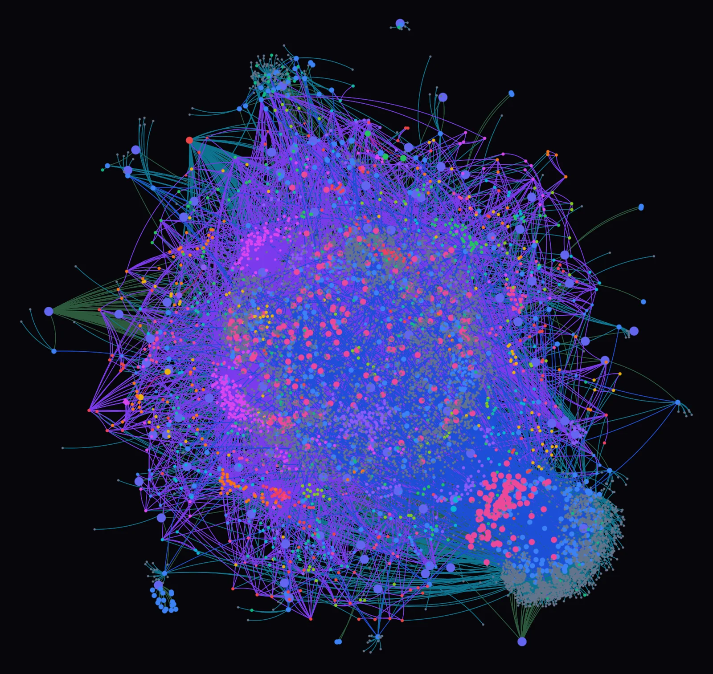
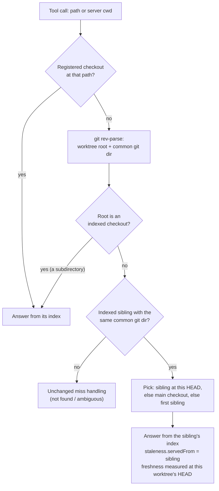

<div align="center">

<picture>
  <source media="(prefers-color-scheme: dark)" srcset="docs/fork/brand/lobi-horizontal-reversed.svg">
  
</picture>

### GitNexus code intelligence for every git worktree

AI coding agents run in parallel, each in its own `git worktree`.<br>
**lobi-GitNexus** gives every one of them the same code knowledge graph, and tells them exactly how fresh it is.

> Agents in a fresh, unindexed worktree: **-32% cost and -55% turns** against plain Claude Code on lobibench v2,<br>
> at 40/45 correct answers against plain's 44/45. Measured, with the tools actually called, and the misses shown below.

<p>
  <a href="#benchmarks"></a>
  <a href="#why-this-fork"></a>
  <a href="https://github.com/abhigyanpatwari/GitNexus"></a>
  <a href="https://modelcontextprotocol.io/"></a>
  <a href="LICENSE"></a>
</p>

<a href="#why-this-fork">Why this fork</a> ·
<a href="#before-and-after">Before and after</a> ·
<a href="#quick-start">Quick start</a> ·
<a href="#how-it-works">How it works</a> ·
<a href="#benchmarks">Benchmarks</a> ·
<a href="docs/fork/gitnexus-reference.md">Full reference</a>

---

### Benchmark: 15 code questions from a fresh worktree (Claude Haiku 4.5, October 2026)

| 3 passes, totals per pass | Plain Claude Code | Upstream GitNexus 1.6.12 | **lobi** |
|---|---:|---:|---:|
| **Correct answers** | **44 / 45** | 42 / 45 | 40 / 45 |
| **Cost** | $0.70 | $0.55 | **$0.48** (-32%) |
| **New tokens** | 114.7k | 78.1k | **75.4k** (-34%) |
| **Wall time** | 515 s | 282 s | **231 s** (-55%) |
| **Turns** | 134 | 70 | **60** (-55%) |
| **Sessions that called gitnexus** | — | 28 / 45 | **36 / 45** |

Every session starts in a linked worktree that has no index, next to a sibling checkout holding someone else's uncommitted edits, on a machine with three repositories indexed.<br>
GitNexus cuts the work roughly in half. Plain Claude Code answered best. The accuracy gap is 4 sessions out of 45 at n = 3 per task, so read it as a warning, not a ranking.<br>
lobi's misses are explained in [Benchmarks](#benchmarks); one of them is a real limit of the worktree fallback.

</div>

---

## Why this fork

[GitNexus](https://github.com/abhigyanpatwari/GitNexus) indexes a codebase into a knowledge graph (every call chain, dependency, cluster and execution flow) and serves it to AI agents through MCP tools such as `impact`, `context`, `query` and `detect_changes`.

Today, agents rarely work in one checkout. Claude Code, Codex and Cursor sessions each get their own `git worktree`, and a new worktree has no index until someone runs `gitnexus analyze` in it. In upstream GitNexus 1.6.12, an agent in a new worktree gets one of three results:

- **A wrong "current".** With one indexed repo, the agent gets the main checkout's graph, and `staleness.status` says `current`. That status is measured against the *main checkout's* HEAD, not the worktree the agent is editing.
- **An error.** With several indexed repos, the call fails with `Multiple repositories indexed`.
- **"Not found".** Passing the worktree path, or any subdirectory of an indexed checkout, as `repo` fails with `Repository "<path>" not found`.

This fork fixes all three. The graph tools (`query`, `context`, `impact`, `cypher`) and `detect_changes` answer from a sibling worktree's index, and they **say so**: the response names the sibling it came from and measures freshness against *your* worktree's HEAD.

---

## Before and after

| Agent works in… | Upstream GitNexus 1.6.12 | lobi-GitNexus |
|---|---|---|
| A new worktree, one repo indexed | Main checkout's graph, reported as `current` | Same graph, with `staleness.servedFrom` set and `status` measured at the worktree HEAD (for example `behind`, 1 commit) |
| A new worktree, several repos indexed | `Multiple repositories indexed` | The sibling worktree of the *same* repository answers |
| `repo: "<absolute worktree path>"` | `Repository "<path>" not found` | The sibling worktree answers, marked `servedFrom` |
| `repo: "<absolute subdirectory of an indexed checkout>"` | `Repository "<path>" not found` | Resolves to that checkout |
| Several indexed siblings | — | Prefers the sibling indexed at the worktree's own HEAD, then the main checkout |
| `detect_changes` for a worktree | Diffs only when the server was *launched* in it | Also diffs the worktree you name with `repo` |
| `rename`, `read_file`, `grep` | Exact checkout only | **Unchanged.** Writes and file reads never use a sibling's checkout |
| `GITNEXUS_MCP_ALLOWED_REPOS` set | Exact allowed checkouts | **Unchanged.** No fallback, so the allowlist cannot widen |
| An unrelated repository, or another submodule of the same superproject | — | **Unchanged.** No fallback across repositories |

The difference that matters is the last column's honesty. An agent can trust an answer it is told is approximate. It cannot trust an answer that is wrong and labelled `current`.

---

## See it

<p align="center">
  
</p>

<p align="center"><sub>The knowledge graph of a private 518-file TypeScript monorepo (main worktree), indexed by lobi-GitNexus in about 3 minutes: 9,582 nodes, 27,633 edges, 199 clusters, 836 execution flows. Rendered by the GitNexus web UI; labels and file names are removed because the code is private.</sub></p>

`gitnexus impact` run against a fresh worktree that is one commit ahead of the indexed main checkout. This is real output from this repository (61,654 symbols), with paths and the branch name generalised. The first call returned in about 3 seconds, with no `analyze` in the worktree:

```jsonc
"staleness": {
  "status": "behind",                      // measured at the worktree's HEAD, not main's
  "branch": "main",
  "lastCommit": "ff922c0a3b0cfc997dfd5b0d35f0c60955f1dc6c",
  "measuredAgainst": "HEAD",
  "commitsBehind": 1,
  "servedFrom": "~/code/my-app",           // the sibling whose index answered
  "hint": "⚠️ Index is 1 commit behind HEAD. Run analyze tool to update. This worktree has no index of its own; answered from sibling worktree ~/code/my-app. Run `gitnexus analyze --index-only` in this worktree for an exact graph."
}
```

Upstream GitNexus returns `Repository "<path>" not found` for the same call.

---

## Quick start

The npm package `gitnexus` is upstream GitNexus. To get this fork, build it from source:

```bash
git clone https://github.com/philong-buile/lobi-GitNexus.git
cd lobi-GitNexus/gitnexus
npm install && npm run build
npm link            # puts this build's `gitnexus` on your PATH
```

Then use it like GitNexus:

```bash
cd /path/to/your/repo
gitnexus analyze    # index the main checkout once
gitnexus setup      # write the MCP config for Claude Code, Cursor, Codex, …
```

Create worktrees as usual (`git worktree add ../feature-x`). Agents in them get answers right away. When a worktree drifts far from its sibling, index it for an exact graph:

```bash
cd ../feature-x && gitnexus analyze --index-only
```

To go back to upstream: `npm unlink -g gitnexus && npm install -g gitnexus`.

---

## How it works



- **Graph tools only.** `query`, `context`, `impact`, `cypher` and `detect_changes` may fall back, and each marks its answer with `staleness.servedFrom`. `read_file` and `grep` would read the sibling's files, and `rename` must edit the checkout you asked for, so none of them falls back.
- **Same repository only.** Siblings are matched by `git rev-parse --git-common-dir` itself, never by name or by its parent folder, so an unrelated repo, or another submodule of the same superproject, cannot answer.
- **Allowlists stay exact.** With `GITNEXUS_MCP_ALLOWED_REPOS` set, the fallback is off.
- **Honest staleness.** The cached freshness check is keyed per worktree, and the `hint` says which sibling answered and how to get an exact graph.
- **No change when nothing falls back.** Calls that resolve to a checkout's own index return exactly what upstream returns.
- **Labelled, not current.** A fallback answer is the sibling's graph. Symbols and call sites your worktree's own commits add or move are not in it until you index the worktree; `commitsBehind` and `servedFrom` say so, but an agent can ignore them (lobibench caught exactly that).

The change lives in [`gitnexus/src/mcp/local/local-backend.ts`](gitnexus/src/mcp/local/local-backend.ts) (`worktreeFallback`) and [`gitnexus/src/core/staleness-status.ts`](gitnexus/src/core/staleness-status.ts) (`servedFrom`).

---

## Verified

- [`worktree-repo-fallback.test.ts`](gitnexus/test/unit/worktree-repo-fallback.test.ts) builds real git repositories with linked worktrees. It covers:
  - an explicit worktree path
  - a subdirectory
  - one repo and several repos selected by cwd
  - preferring the sibling indexed at the worktree's HEAD
  - `rename`, `read_file` and an explicit opt-out never falling back
  - no fallback across repositories, or between two submodules of one superproject
  - `detect_changes` diffing the asked-about worktree, even when the sibling that answers is itself a linked worktree
  - the `servedFrom` payload

  The real staleness check runs; only the registry and database are stubbed.
- The existing MCP, staleness, repository-policy and `detect_changes` suites pass.
- Smoke test with the real CLI against a fresh worktree:
  - `impact` returns the response shown above.
  - `detect-changes --repo <worktree>` diffs that worktree, even when started from another directory.

```bash
cd gitnexus
npx vitest run test/unit/worktree-repo-fallback.test.ts
npx tsc --noEmit
```

---

## Benchmarks

Three measurements, from broad to narrow. Each one says what it cannot show.

### lobibench: an agent benchmark with planted traps

Modeled on [token-savior's tsbench](https://github.com/mibayy/token-savior#reproducing-the-tsbench-score). Real headless Claude Code sessions answer read-only questions about a generated TypeScript repository (180 files, identical on every run) and end with `ANSWER: [...]`. Each task has an `expected` list (all must appear) and a `forbidden` list (none may appear), so an answer that names the right symbol *and* a wrong one fails. Method, traps and raw tables: [`docs/fork/bench/`](docs/fork/bench/README.md).

- **Three arms.** `plain` (built-in Read/Grep/Glob/Bash only), `upstream` (registry `gitnexus@1.6.12`, installed into a private prefix) and `lobi` (this fork). Same prompt, same model, each MCP arm with its own `GITNEXUS_HOME`.
- **A realistic machine.** Each MCP arm indexes the repository's main checkout plus two unrelated repositories. Every session runs in a linked worktree with no index; the main checkout holds someone else's uncommitted edit.
- **Traps.** A name defined in three modules, a 4-5 level call chain, an import cycle, a dead `computeTax` next to a live `computeTaxRate`, table dispatch, aliased imports, a barrel re-export, symbol names that appear only in comments and strings, and a worktree one commit ahead of the index.
- **The tools must actually be called.** The server is `alwaysLoad`, so Claude Code does not hide its tools behind ToolSearch, and a pass in which an MCP arm never calls gitnexus is marked invalid instead of averaged. token-savior withdrew a published measurement for exactly this bug. No pass was invalid here.
- **The developer's setup is switched off in every arm.** User settings, hooks, plugins, skills, other MCP servers, `CLAUDE.md` and auto-memory. The last two rely on environment variables that the session cannot confirm.
- **Tasks were written before the first run** and not changed after.

**v2 results** (15 tasks, 3 passes, Claude Haiku 4.5, Claude Code 2.1.263, Windows 11, 2026-10-12, $5.19): the table at the top of this page. Per task, every arm got 3/3 except:

| Task | plain | upstream | lobi | What happened |
|---|---:|---:|---:|---|
| import cycle | 2/3 | 3/3 | 3/3 | plain dropped the `src/` prefix once |
| dead code | 3/3 | 2/3 | 3/3 | upstream named the live `computeTaxRate` too |
| 5-level call chain | 3/3 | 3/3 | **1/3** | lobi's agent kept `impact`'s default depth of 3; upstream's passed a larger `maxDepth`. Agent behavior, same default in both servers |
| callers in a worktree one commit ahead | 3/3 | 1/3 | **0/3** | see below |

**The real limit it found.** In the worktree that is one commit ahead, lobi diffed the right tree and found the changed function, then asked `context` for its callers. The answer came from the sibling's index, one commit old, so it listed the old caller. The response said so (`commitsBehind: 1`, `servedFrom`), and Haiku ignored it. The fallback makes diffs correct and stale graphs *labelled*; it does not make a stale graph current. If a worktree's changes move call sites, run `gitnexus analyze --index-only` in it.

**What upstream did.** In 28 of 45 sessions upstream's agent passed `repo: "."` and got `Repository "." not found. Available: cli-tool, main, notes-app`, then listed repositories or guessed `main`. It always recovered: 29 of its 88 calls were errors, which cost turns rather than answers. It never called `detect_changes`, so the wrong-tree diff from the [A/B evaluation](#ab-evaluation-one-real-task) never had a chance to happen. lobi's agent mostly omitted `repo` and got answers: 10 errors in 64 calls.

**v1** (8 easier tasks, one indexed repository, 3 passes, $2.64): all three arms scored 24/24, and both MCP arms cost 57-59% less than plain and took about a quarter of the turns. With one repository indexed, upstream resolves a fresh worktree to it, so v1 could not separate upstream from lobi. That is why v2 exists.

**Data files** (`--suite data`: 12 tasks plus 1 privacy task on a Python repo that reads 15 synthetic CSV/TSV files, 3 passes, Claude Haiku 4.5, 2026-10-12, $4.41). The traps are overlapping column names, a path held in a constant, a 2.9 MB CSV, a text-only CSV, dead files, and files mentioned only in docs or comments:

| 3 passes, totals per pass | Plain Claude Code | Upstream GitNexus 1.6.12 | **lobi** |
|---|---:|---:|---:|
| **Correct answers** | 36 / 36 | 36 / 36 | 35 / 36 |
| **Cost** | $0.43 | $0.51 | $0.47 |
| **New tokens** | 85.8k | 82.6k | 79.3k |
| **Wall time** | 208 s | 232 s | 215 s |
| **Turns** | 79 | 84 | 83 |
| **Sessions that called gitnexus** | — | **0 / 39** | **0 / 39** |
| **Privacy task / answers that quoted a personal value** | 3/3, 0 | 3/3, 0 | 3/3, 0 |

**No agent used the tools, so every MCP pass is invalid** and this table is plain Claude Code three times. On a 31-file repo, one Grep for a file name answers the question, and nothing in the tool descriptions says the graph knows about data files. The one miss was a Grep-only session that counted a doc mention as use.

**What the lobi index would have answered.** Queried directly, it gets 5 of 12 right on its own. Upstream 1.6.12 indexes no CSV at all. lobi's misses:

- A string in a code comment creates a false `USES` edge, which spoils two tasks.
- Files under `fixtures/` are not indexed.
- Neither is the 2.9 MB CSV.
- The text-only CSV has no columns, by design.

Those three fixable gaps, and a run on the masking task with a real workbook (lobi made no gitnexus calls there either), are written up in [`docs/fork/bench/`](docs/fork/bench/README.md#result-data-2026-10-12).

**Limits.** One cheap model, n = 3 per task, one synthetic repository. The cost and turn gaps against plain are several standard deviations wide; the accuracy gaps and the lobi-against-upstream cost gap (about 1.3 sd) are not. Bash is available in every arm, so "read-only" is a prompt rule, backed by resetting and hashing the fixture after every session (0 of 135 sessions changed it).

### A/B evaluation: one real task

One real coding task, run twice in parallel by a headless agent: once with upstream GitNexus, once with this fork.

**Task.** A follow-up to a code-review comment on a Python web backend (FastAPI). An app-wide auth guard compared its public-route allowlist against the router-local route path, so a route on a prefixed router could match a public entry. Fix it, update two stale comments, and add a regression test.

**Setup.** Same prompt, same model (`claude -p --model opus`, resolved to `claude-opus-5`, Claude Code 2.1.263), Windows 11, `--strict-mcp-config` with only the gitnexus MCP server. Each agent started in its own fresh linked worktree at the same commit, and that worktree was **not indexed**, which is the normal state for a worktree created moments ago.

- **A, upstream 1.6.4** (npm global): the global registry held other worktrees of the same repo at various commits. One sibling, `worktree-S`, was at the same HEAD and held another session's uncommitted edits to the same files.
- **B, lobi** (1.6.12 base plus the worktree fallback, `a7063a26`): its own `GITNEXUS_HOME`, with one sibling indexed at the same HEAD (`analyze`: 72.9 s, about 21.8k nodes and 51k edges; the first attempt failed with "Analyzer build changed while its identity was being computed" and a plain retry succeeded).

| | A: upstream 1.6.4 | B: lobi |
|---|---|---|
| Cost | $2.31 | $2.52 |
| Wall time | 256 s | 250 s |
| Turns | 25 | 25 |
| gitnexus calls / errors | 6 / 0 | 5 / 0 |
| Tests | 38 passed | 38 passed |
| `detect_changes` diffed | **`worktree-S`** (someone else's edits) | the agent's own worktree |

**What happened.**

- A found no index for its own worktree, so it passed `worktree-S`'s path as `repo`. `context` and `impact` were fine: at the same commit the graph is identical.
- `detect_changes` then diffed `worktree-S`'s working tree and reported another session's uncommitted changes as the agent's own. It listed a variable `route` as touched; only `worktree-S`'s diff removed that line, while the agent's own diff kept it. The agent explained the mismatch away as "line-offset drift" and reported success. A silent wrong answer.
- B called `detect_changes(worktree=<own path>)`. The sibling's index answered, but the diff was the agent's own tree: its changed symbols and affected processes matched the agent's real edits.
- In both arms `impact` returned 0 upstream callers for a function reached only through a dependency-injection reference (`Depends(fn)`). Both agents fell back to grep. The fork does not change that.

**Limits.**

- n = 1 per arm. This is an anecdote, not a benchmark.
- The arms differ in version (1.6.4 vs a 1.6.12 base), so the difference is not only the fallback feature.
- User-level Claude Code hooks were active in both arms.
- The fair claim is about the correctness of `detect_changes` in an unindexed worktree. Cost and time are within noise; no claim about speed or cost.

**Reproduce.** Create two fresh worktrees at one commit, leave them unindexed, and index a sibling worktree of the same repo (for arm A, ideally one with uncommitted edits). Give each arm an MCP config with only gitnexus (arm B sets `GITNEXUS_HOME` to its own directory), then run:

```bash
claude -p "$(cat prompt.md)" --model opus --strict-mcp-config --mcp-config mcp-<arm>.json \
  --output-format stream-json --verbose > <arm>.jsonl
python docs/fork/ab-eval/analyze.py upstream.jsonl lobi.jsonl
```

[`analyze.py`](docs/fork/ab-eval/analyze.py) prints cost, duration, turns, tool counts and each `detect_changes` changed-symbol list. The transcripts and prompt are not published because they contain a private codebase.

### Deterministic worktree benchmark

A repeatable, LLM-free check of the failure in the A/B run: `gitnexus/test/integration/worktree-tools-benchmark.test.ts`. It builds a three-file TypeScript repo with real git, indexes only the `main` checkout with the real `analyze`, then asks the MCP read tools about two linked worktrees that have no index (`wt-agent`, detached at the same commit with an uncommitted edit to `add`; `wt-ahead`, one commit ahead with an uncommitted edit to `total`). `main` also carries someone else's uncommitted edit to `mul`. Answers are graded against what the fixture says they must be: `correct`, `error`, or `silent-wrong`.

- **lobi**: default behavior, worktree fallback on.
- **upstream-behavior**: `callTool(..., { worktreeFallback: false })`. If that errors, retry once with `repo` set to the indexed sibling, as the agent did in the A/B run.

Only the lobi arm is asserted; the other arm is measured, not guarded. The upstream-behavior arm runs this fork's code with the fallback switched off, not an upstream release, so it isolates the fallback rather than every difference between versions. Its timings include the failed first call plus the retry, which is what an agent pays.

```bash
cd gitnexus && npm run build
GITNEXUS_E2E_CLI=dist GITNEXUS_BENCH=1 npx vitest run test/integration/worktree-tools-benchmark.test.ts --reporter=verbose
```

JSON goes to `$GITNEXUS_BENCH_OUT` (default `<tmpdir>/gitnexus-worktree-bench.json`). Results, Windows 11, Node v24.14.0, gitnexus 1.6.12; `analyze` took about 31 s for a 10-node, 17-edge graph (19.8 kB of index). Median of 5 calls:

| Scenario | lobi | ms | upstream-behavior | ms |
|---|---|---|---|---|
| D1 `detect_changes` on indexed `main` (expect `mul`) | correct | 650 | correct | 656 |
| D2 `detect_changes` on `wt-agent` (expect `add`) | correct | 126 | silent-wrong (`mul`, main's diff) | 690 |
| D3 `detect_changes` on `wt-ahead` (expect `total`) | correct, flagged `behind` by 1 | 159 | silent-wrong (`mul`) | 670 |
| I1 `impact add` upstream from `wt-agent` | correct | 202 | correct (after retry) | 192 |
| C1 `context total` from `wt-ahead` | correct | 234 | correct (after retry) | 172 |

Read-only graph lookups survive the retry because the graph is the same at the same commit. `detect_changes` does not: the retry diffs the sibling's working tree, so it reports another checkout's edits with no error. Latencies are for a toy repo and mostly show per-call overhead.

### Bench it yourself

```bash
# LLM-free worktree benchmark (about a minute)
cd gitnexus && npm run build
GITNEXUS_E2E_CLI=dist GITNEXUS_BENCH=1 npx vitest run test/integration/worktree-tools-benchmark.test.ts --reporter=verbose

# lobibench agent benchmark (about 90 minutes and $5-6 on Haiku for v2)
python docs/fork/bench/run.py --suite v2 --arms plain,upstream,lobi --passes 3 --model haiku --out <dir>
```

One trap if you rebuild lobibench elsewhere: `claude -p` inherits your user settings, hooks and plugins unless you switch them off, and anything that steers tool use then applies to the control arm too. The runner passes `--setting-sources project`, `--disable-slash-commands` and `--strict-mcp-config`; see [`docs/fork/bench/README.md`](docs/fork/bench/README.md) for the full command.

---

## Everything else is GitNexus

Apart from worktree handling, this fork is GitNexus 1.6.12:

- 19 MCP tools: `impact`, `context`, `query`, `detect_changes`, `rename`, `cypher`, `trace`, `route_map`, `shape_check` and more.
- Precomputed clusters, execution flows and confidence-scored call chains, so one tool call returns complete context.
- Agent skills, Claude Code hooks, `gitnexus setup` for every major editor, wiki generation, and a web UI.

The complete upstream guide (installation problems, CLI reference, editor setup, Docker, embeddings, tool examples) is in **[docs/fork/gitnexus-reference.md](docs/fork/gitnexus-reference.md)**.

---

## Staying in sync with upstream

```bash
git remote add upstream https://github.com/abhigyanpatwari/GitNexus.git
git fetch upstream && git merge upstream/main
```

---

## Credits and license

lobi-GitNexus is a fork of [GitNexus](https://github.com/abhigyanpatwari/GitNexus) by Abhigyan Patwari. All credit for the engine belongs to the GitNexus authors and contributors. This fork adds worktree-aware repository resolution and its own [identity](docs/fork/brand/README.md); it is not affiliated with or endorsed by upstream.

Licensed under the [PolyForm Noncommercial License 1.0.0](LICENSE), the same as upstream.

Required Notice: Copyright Abhigyan Patwari (https://github.com/abhigyanpatwari/GitNexus)
